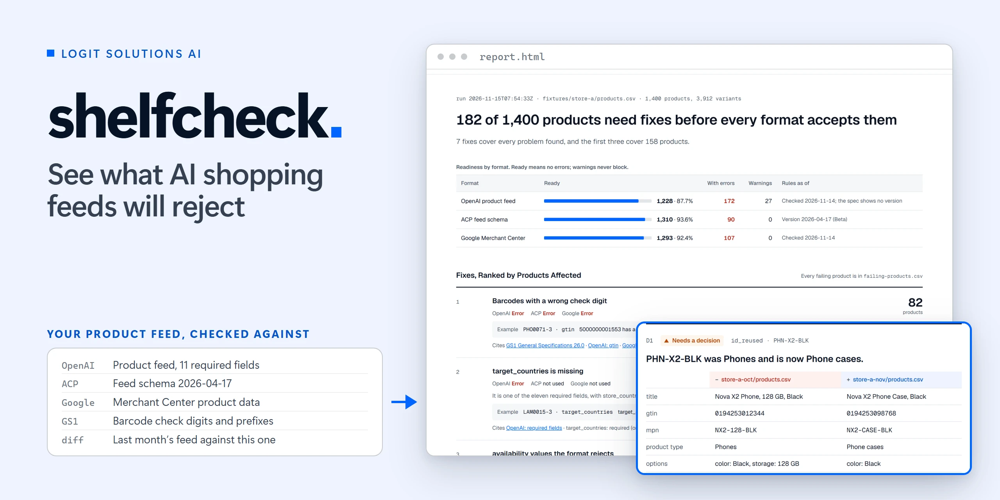
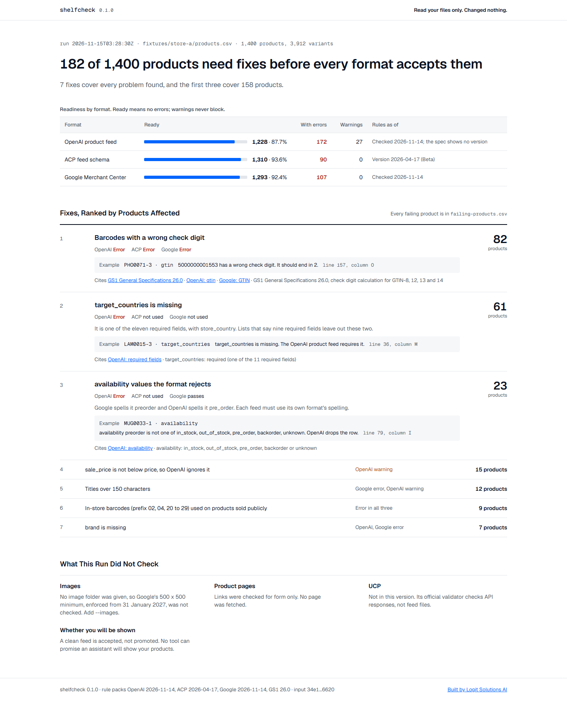
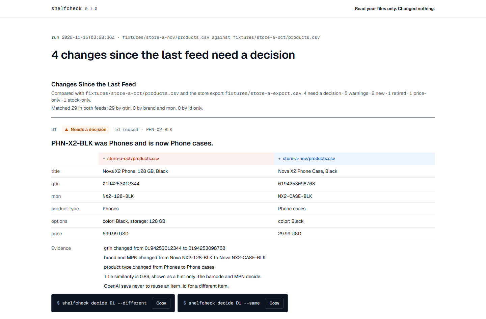

<p align="center">
  <picture>
    <source media="(prefers-color-scheme: dark)" srcset="docs/media/hero-dark.webp">
    <source media="(prefers-color-scheme: light)" srcset="docs/media/hero-light.webp">
    
  </picture>
</p>

# shelfcheck

shelfcheck checks your product feed against the formats AI shopping assistants read, and tells you what changed since your last feed in ways that will cause problems.

## An Example

A store exports its 1,400 products and runs `shelfcheck check`. The report says 212 products need fixes before every format accepts them, and ranks the fixes by how many products each one affects:
- 84 barcodes with a wrong check digit, each showing the digit it should end in;
- 61 products missing `target_countries`;
- 23 products marked `preorder`, which one format accepts and another rejects.

Then the store runs `shelfcheck diff` against last month's feed. It finds an id that now belongs to a different product, and a tablet whose storage changed from 128 GB to 256 GB under the same id and barcode while the store title still says 128 GB.

The numbers in this example are illustrative, not measured results.

## A Real Run

On the synthetic 1,400-product feed in `fixtures/store-a/` (a debug build on a Windows 11 laptop that was running other builds, 2026-11-15):

```text
$ shelfcheck check fixtures/store-a/products.csv
shelfcheck 0.1.0 · rules OpenAI 2026-11-14 · ACP 2026-04-17 · Google 2026-11-14 · GS1 26.0

read      OpenAI CSV · 1,400 products, 3,912 variants                     0.30 s

          ready            errors   warnings
OpenAI    1,228    87.7%   172      27
ACP       1,310    93.6%   90       0
Google    1,293    92.4%   107      0

✗   82  Barcodes with a wrong check digit       OpenAI, ACP, Google · e.g. PHO0071-3, line 157
✗   61  target_countries is missing             OpenAI · e.g. LAM0015-3, line 36
✗   23  availability values the format rejects  OpenAI · e.g. MUG0033-1, line 79
    + 4 more fixes, 43 products. All of them are in the report.

182 of 1,400 products need fixes before every format accepts them.
report    shelfcheck-results/report.html   sarif results.sarif   csv failing-products.csv
```

## The Report

The top of `report.html` from that run. The report follows your system's light or dark setting.

<picture>
  <source media="(prefers-color-scheme: dark)" srcset="docs/images/report-check-dark.png">
  
</picture>

The changes section of the report from `shelfcheck diff fixtures/store-a-oct/products.csv fixtures/store-a-nov/products.csv --store fixtures/store-a-export.csv`:

<picture>
  <source media="(prefers-color-scheme: dark)" srcset="docs/images/report-diff-dark.png">
  
</picture>

## What It Checks

Every product in your feed, against:

- The OpenAI product feed for ChatGPT shopping
- The Agentic Commerce Protocol (ACP) feed schema
- Google Merchant Center product data, including its conversational attributes
- GS1 barcode rules: check digits, and prefixes that should never appear on products sold publicly

When you give it more than one feed, it also checks that price, availability, brand and barcode agree across them.

Each format is held to its own wording. A barcode written with spaces or dashes is an error for the OpenAI product feed, which asks for none, and is read without them for Google, which accepts and ignores them.

Not read in this version: Google's `question_and_answer` attribute, which Google writes as quoted pairs separated by commas. When a feed has it, the run says so in one line under "What This Run Did Not Check" and reports no problem for it.

## What It Compares

Given an old feed and a new one, shelfcheck flags:
- an id reused for a different product;
- the same product under a new id;
- a variant whose storage, size, colour, material or pack quantity changed under the same id, with the same barcode or, when there is no barcode, the same brand and MPN;
- store titles that still describe the old variant.

You record a decision for each change once, and shelfcheck remembers it.

## How It Works

1. Point it at a CSV, TSV, JSONL, Google XML or ACP feed, or a Shopify product export.
2. Every rule is written as code, not left to a language model, so the same feed always gets the same result.
3. Rules live in data files that record their source and the date they were last checked, and every problem cites its rule.
4. You get a report, a list of failing products, and results for your code scanning and CI tools.

## Commands

```text
shelfcheck check <feed>... [--formats openai,acp,google] [--format F] [--images DIR] [--rules DIR] [--ignore RULE]... [--redact FIELD,...] [--out DIR] [--fail-on warning]
shelfcheck diff <old> <new> [--store FILE] [--decisions FILE] [--out DIR] [--fail-on warning]
shelfcheck decide <change-id> --same | --different | --fixed [--note TEXT]
shelfcheck rules list | describe <rule-id>
shelfcheck init [<feed>]
```

Global flags: `--quiet`, `--json`, `--color auto|always|never`, `--config FILE`.

Exit codes: `0` clean, `1` errors or undecided changes found, `2` invalid input or config, `3` a required file is missing or unreadable, `4` internal error.

A feed with no product rows (an empty file, a header row only), a semicolon-separated file, or a file whose header has no known feed column is invalid input (`2`), never a clean run.

`results.json` and `results.sarif` are the same for the same input on any run. `report.html` shows when it was run; set `SOURCE_DATE_EPOCH` to make it repeatable too.

## Outputs

Each run writes a `shelfcheck-results/` folder:
- `report.html`: one file that works offline;
- `results.json`: every problem and change, with its file, line and column;
- `results.sarif`: SARIF 2.1.0 for code scanning, with at most 25,000 results, the most a GitHub code scanning run accepts (errors first; the file says how many were left out);
- `failing-products.csv`: one row per failing item, with its rule ids and sentences;
- `junit.xml`: one test case per rule pack and one per change kind.

Decisions go in `shelfcheck-decisions.toml`, which is meant to be committed. A decided change stays quiet while its fingerprint is the same.

## Rule Packs

| Pack | Source | Checked |
|---|---|---|
| OpenAI product feed (file upload) | https://developers.openai.com/commerce/specs/file-upload/products (the page shows no version) | 2026-11-14 |
| ACP feed schema, version 2026-04-17 (Beta) | https://github.com/agentic-commerce-protocol/agentic-commerce-protocol, vendored unmodified | 2026-11-14 |
| Google Merchant Center product data, with the conversational attributes | https://support.google.com/merchants/answer/7052112 | 2026-11-14 |
| GS1 GTIN rules, General Specifications 26.0 | https://www.gs1.org/standards/barcodes-epcrfid-id-keys/gs1-general-specifications | 2026-11-14 |

`shelfcheck rules list` prints every rule, and `shelfcheck rules describe <rule-id>` prints its source wording. The formats change often, so each pack records the date it was checked.

To report a stale rule, open an issue with the rule id, a link to the source page, the text that changed and the date you read it.

## What Passing Means

A feed that passes shelfcheck is accepted by the formats checked, as far as these rules go. Passing does not mean an AI assistant will show your products.

## Proof

- Against the gold fixtures, measured 2026-11-15: all 674 expected problems in two `check` cases and all 28 expected changes in two `diff` cases were found, with none extra. The fixtures and the gold file come from the same script, `fixtures/generate.py`, so this shows agreement with that script, not accuracy on real feeds. Separate hand-written fixtures in `fixtures/hand/` have expected values worked out by hand from the rule sources.
- Speed, measured 2026-11-15 on an idle Windows 11 laptop (Intel Core i7-1280P, 20 threads, 16 GB): one million generated rows checked against OpenAI, ACP, Google and GS1 in 8.27 to 8.40 seconds across four warm runs (the first, cold run took 12.26 seconds). Run it yourself with `cargo test --release -p shelfcheck --test perf one_million_rows -- --ignored --nocapture`.

## Privacy and Safety

- It reads your files only. It never changes your store, and it does not connect to the internet. Links in a feed are checked for form, never fetched.
- The report and SARIF hold only the fields a problem needs; `--redact` removes the values of more fields.

## Install

```sh
npx shelfcheck check products.csv                 # npm, without installing
npm install -g shelfcheck                         # npm
brew install logitsolutionsai/tap/shelfcheck      # Homebrew (macOS, Linux)
cargo install shelfcheck                          # crates.io
curl --proto '=https' --tlsv1.2 -LsSf https://github.com/logitsolutionsai/shelfcheck/releases/latest/download/shelfcheck-installer.sh | sh
```

Prebuilt binaries for macOS, Linux and Windows, and a PowerShell installer, are on the [releases page](https://github.com/logitsolutionsai/shelfcheck/releases/latest). Each release archive includes `THIRD-PARTY-LICENSES.html`, the licences of every crate built into the program.

## Learn More

shelfcheck is part of our guide to [AI in eCommerce](https://logitsolutions.ai/guides/ai-in-ecommerce/).

## About Logit Solutions AI

Logit Solutions AI is an AI product studio delivering production-ready AI products end to end, with ongoing support for startups and growing businesses. To discuss your own project, [book a free AI consultation](https://logitsolutions.ai/contact/).

## License

Apache-2.0
